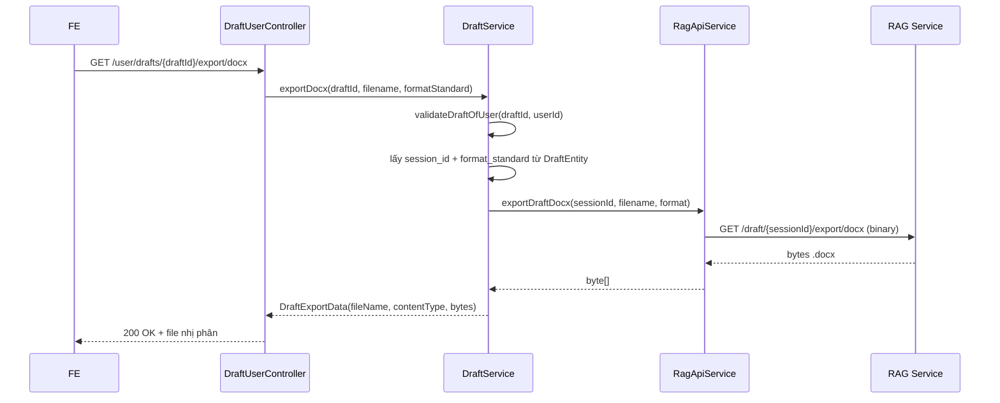

# Xuất bản soạn thảo ra file Word (.docx)

## Mục đích

Cho phép người dùng tải bản soạn thảo (draft) hiện tại về dưới dạng file Word `.docx`.
RAG service đã có sẵn API sinh file; core-service chỉ đóng vai trò **proxy** để FE không phải
biết `session_id` và không phải gọi trực tiếp RAG.

## API dành cho FE

```
GET /user/drafts/{draftId}/export/docx
```

| Param            | Kiểu   | Bắt buộc | Mô tả                                                                 |
| ---------------- | ------ | -------- | --------------------------------------------------------------------- |
| `draftId` (path) | UUID   | ✅       | ID bản soạn thảo                                                       |
| `filename`       | string | ❌       | Tên file tùy chỉnh (không cần đuôi `.docx`, server tự thêm)           |
| `format_standard`| string | ❌       | Ghi đè chuẩn định dạng; bỏ trống thì dùng `formatStandard` của draft  |

Ví dụ:

```bash
curl -X GET 'http://localhost:8002/draft/{draftId}/export/docx?format_standard=nd30_2020' \
  -H 'Authorization: Bearer <access_token>' -o 'ke-hoach.docx'
```

Response: **nhị phân** (`application/vnd.openxmlformats-officedocument.wordprocessingml.document`)
kèm header `Content-Disposition: attachment; filename=...`.

## Vì sao FE không cần truyền tham số như API RAG

API gốc của RAG là `GET /draft/{session_id}/export/docx?filename=&format_standard=`.
core-service suy ra các tham số này từ dữ liệu đã có trong DB:

| Tham số RAG       | Nguồn suy ra trong core-service                                    |
| ----------------- | ------------------------------------------------------------------ |
| `session_id`      | `draft.session_id` — được lưu tự động sau lần chat với AI đầu tiên |
| `format_standard` | `draft.format_standard` (FE có thể override qua query param)      |
| `filename`        | `filename` FE truyền, nếu trống thì sinh từ `draft.title`           |

## Luồng xử lý



## Quy tắc & ràng buộc

- **Ownership:** bắt buộc là chủ của draft (`validateDraftOfUser`) — dùng JWT user id, giống các API draft khác.
- **Chưa có session:** nếu `draft.session_id` rỗng (chưa từng chat với AI) → trả `DRAFT_EXPORT_NOT_AVAILABLE` (409)
  vì RAG chưa có nội dung để export.
- **Tên file:** được sanitize (bỏ `\ / : * ? " < > |` và ký tự điều khiển), tự thêm `.docx` nếu thiếu.
  Không truyền `filename` thì lấy `draft.title`.
- **Encode:** `filename` và `format_standard` được encode query (`UriUtils.encodeQueryParam`), `session_id`
  encode path segment → tên file tiếng Việt/ký tự đặc biệt không làm hỏng URL.
- **Không có JSON response:** endpoint trả file nhị phân trực tiếp (không bọc `ApiResponseModel`),
  giống các endpoint download source của Topic/Notebook/Draft.

## Xử lý lỗi

| Error code                       | HTTP | Nguyên nhân                                             |
| -------------------------------- | ---- | ------------------------------------------------------- |
| `DRAFT_ID_NOT_EXISTS` (1138)     | 404  | Draft không tồn tại                                     |
| `PERMISSION_DENIED`              | 403  | Không phải chủ draft                                    |
| `DRAFT_EXPORT_NOT_AVAILABLE` (1207) | 409 | Draft chưa có session (chưa chat với AI) hoặc RAG trả 404 |
| `INVALID_REQUEST_INFORMATION` (1172) | 400 | RAG trả 4xx (tham số không hợp lệ)                  |
| `DRAFT_EXPORT_FAILED` (1208)     | 502 | RAG lỗi 5xx hoặc trả nội dung rỗng                      |

## Audit

Service method được gắn `@Audited(action = DOWNLOAD, resource = DRAFT, ...)` để ghi log ai đã export draft nào.

## Liên quan

- Endpoint gốc của RAG: `GET /draft/{session_id}/export/docx` (do RAG service quản lý, không sửa ở core-service).
- `session_id` được lưu tại `RagService` sau khi stream chat draft hoàn tất (`draftService.updateSessionId`).
